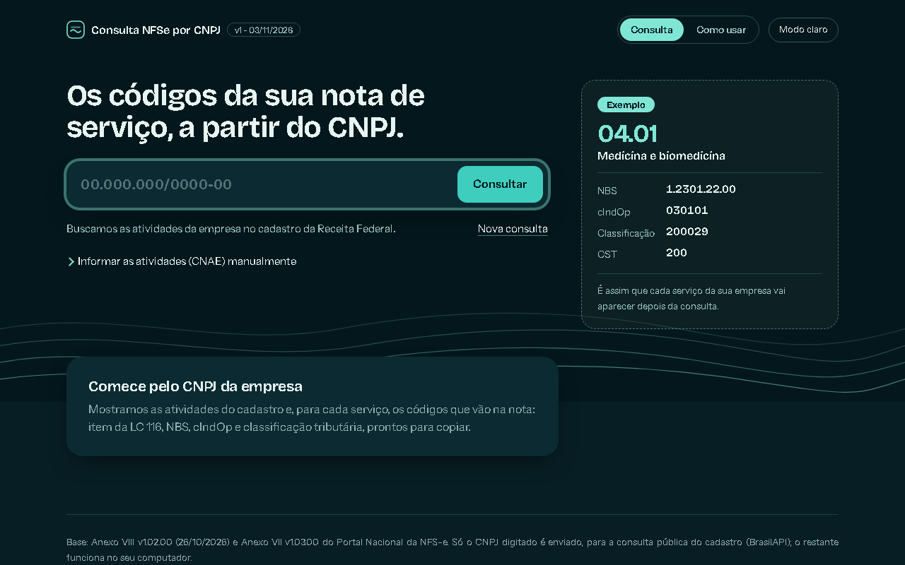
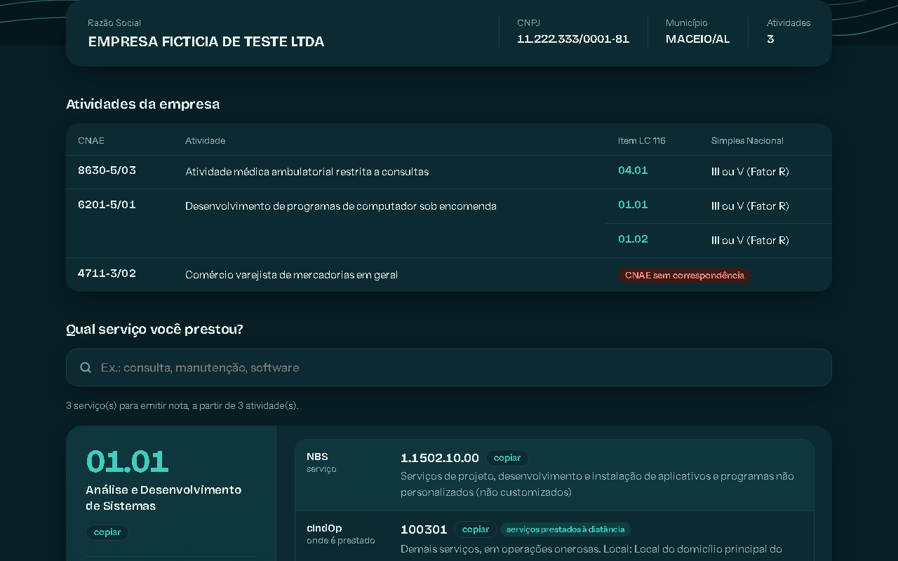
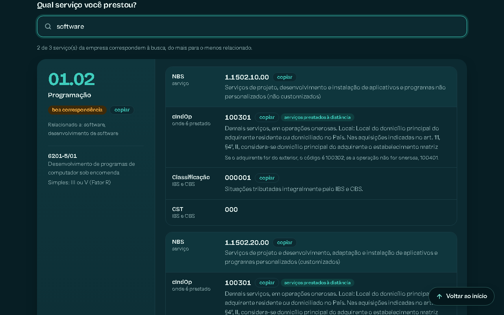
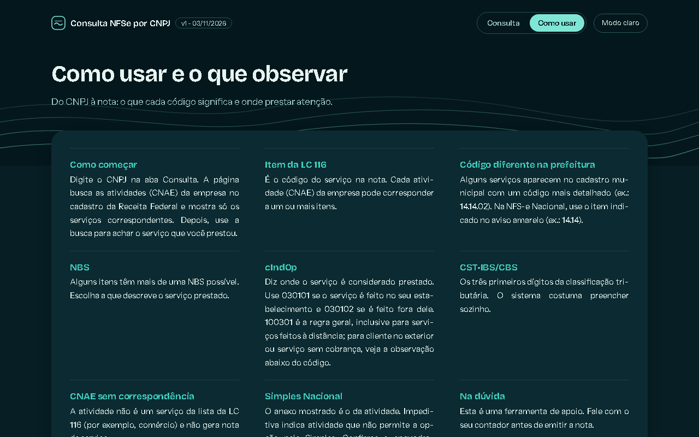
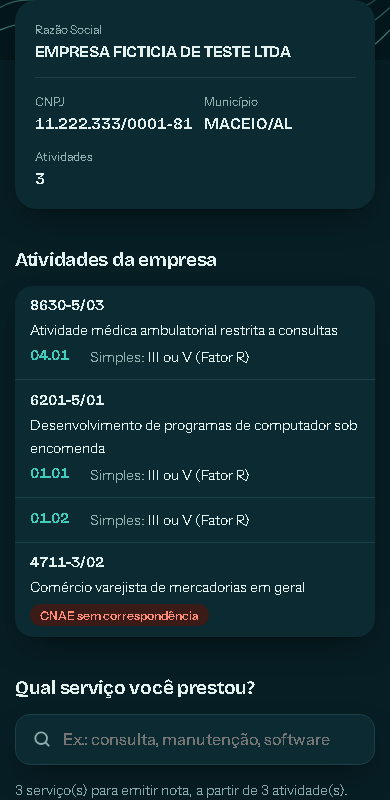

# Consulta NFSe por CNPJ

Página HTML em arquivo único, para enviar aos clientes. O cliente digita o CNPJ, a página busca as atividades (CNAE) na Receita Federal e mostra **só** os serviços correspondentes, com os códigos da NFS-e Nacional:

- item da LC 116 (e o código municipal, quando Maceió usa um subitem, ex.: 14.14.02 → 14.14);
- NBS, cIndOp e cClassTrib/CST (Anexos VII e VIII do Portal Nacional da NFS-e);
- anexo do Simples Nacional, com destaque para atividade impeditiva.

A alíquota de ISS não é mostrada: ela varia com o faturamento.

Também traz uma busca por descrição ("consulta", "software", "manutenção"), restrita aos serviços da empresa, com os selos "NBS mais provável" e "boa correspondência". A aba "Como usar" explica a página ao cliente.

## Telas
Capturas em modo escuro, com empresa fictícia (BrasilAPI simulada). A página também tem modo claro, pelo botão no topo.






No celular:



## Como usar
Abra o arquivo `dist/Consulta NFSe por CNPJ - vN - DD-MM-AAAA.html` no navegador. Não precisa instalar nada.
A única conexão é a consulta do CNPJ na [BrasilAPI](https://brasilapi.com.br). Se ela falhar, dá para colar os CNAEs em "Informar as atividades (CNAE) manualmente".

## Como atualizar
A planilha de correlação CNAE → item LC 116 **não vem neste repositório**. Para gerar a página, coloque a sua em `dados/correlacao/`, com a aba "Correlação" e as colunas: A = CNAE, B = descrição, C = item LC 116, H = anexo do Simples, I = descrição do anexo. A coluna de alíquota é ignorada de propósito.

Requisitos: Python 3 com `openpyxl`; para os testes, `playwright` (`pip install playwright` e `playwright install chromium`).

```
python src/atualizar.py --anexo8 "dados/oficial/<Anexo VIII>.xlsx" --anexo7 "dados/oficial/<Anexo VII>.xlsx" --correlacao "dados/correlacao/Correlacao CNAE Maceio.xlsx" --versao "vN - DD/MM/AAAA"
python testes/teste_pagina.py "dist/Consulta NFSe por CNPJ - vN - DD-MM-AAAA.html"
```

A cada atualização, suba o número da versão e use a data do dia. Atualize também o rodapé da página (`src/template.html`) com a versão dos Anexos.
Os Anexos ficam em https://www.gov.br/nfse/pt-br/biblioteca/documentacao-tecnica/rtc (baixar manualmente). O projeto `nfse-consulta` usa os mesmos Anexos: atualize os dois.

## Estrutura
| Pasta | Conteúdo |
|---|---|
| `dados/oficial/` | Anexos VII e VIII |
| `dados/correlacao/` | Sua planilha de correlação CNAE → item LC 116 (local, fora do repositório) |
| `dados/processado/` | CSVs e `dados.json` gerados pelo pipeline (local, fora do repositório) |
| `src/` | Pipeline (normalização, JSON, montagem) e modelo da página |
| `testes/` | Teste de navegador (BrasilAPI simulada, CNPJs fictícios) |
| `dist/` | Páginas geradas, uma por versão |
| `revisao/` | Planilha para revisão fiscal do vocabulário de busca (`gera_revisao.py <raiz> <saida.xlsx>`) |

Etapas de construção: `ETAPAS.md`. Termos: `GLOSSARY.md`.

## Licença
Código sob [licença MIT](LICENSE). Os Anexos VII e VIII em `dados/oficial/` são documentos do Portal Nacional da NFS-e e não são cobertos por ela. As fontes têm licença própria (abaixo).

## Fontes
Bricolage Grotesque e Instrument Sans (SIL Open Font License 1.1, licenças em `src/fontes/`), embutidas no HTML para a página funcionar sem internet.
